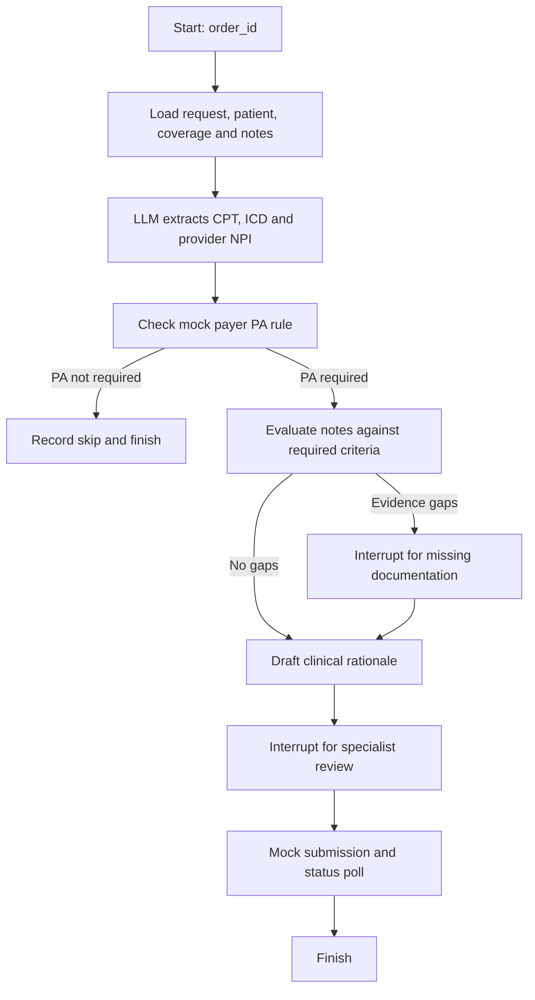

# Provider Prior Authorization Agent

A Python/LangGraph prototype for a provider-side prior authorization (PA) workflow. It uses an LLM to extract clinical codes, compare clinical notes with payer criteria, draft a rationale, pause for human review, and simulate submission/status tracking.

> **Prototype only:** EHR, payer-rules, coverage, clearinghouse, and payer-status integrations are hard-coded mocks. This project is not connected to real healthcare systems and is not production-ready or a clinical decision system. Do not use real patient information or rely on its output for care or coverage decisions.

## What it does

The registered graph is `provider_pa_agent`, exported as `graph` from `src/provider_pa_agent/main_graph.py`.



### Architecture and code map

| Path | Responsibility |
| --- | --- |
| `src/provider_pa_agent/main_graph.py` | Top-level graph composition and exported `graph`. |
| `src/provider_pa_agent/state.py` | Shared `ProviderPAState` passed between graph nodes. |
| `src/provider_pa_agent/config.py`, `llm.py` | Environment configuration and OpenAI/Groq model factory. |
| `src/provider_pa_agent/objects.py`, `prompt.py` | Pydantic structured-output models and LLM instructions. |
| `src/provider_pa_agent/nodes/` | Request/context loading, extraction, evidence evaluation, review, submission, and response handlers. |
| `src/provider_pa_agent/sub_graphs/` | Intake, evidence evaluation, submission, and payer-response graph builders. |
| `src/provider_pa_agent/mcp_servers.py` | In-process mock EHR, payer-rules/coverage, and clearinghouse adapters. |
| `langgraph.json` | LangGraph CLI registration for local development and image builds. |

`sub_graphs/response.py` defines approval, additional-information, and denial handling, but the response graph is **not connected** to `main_graph.py`; the top-level graph currently ends after its submission/status simulation.

## Requirements

- Python **3.13** (the project requires Python `>=3.13`).
- [`uv`](https://docs.astral.sh/uv/) for dependency management.
- Docker, only for the container-based local or production workflows.
- An API key for one supported LLM provider.

Run commands from the `provider-pa-agent/` directory:

```bash
cd provider-pa-agent
uv sync --locked
```

`pyproject.toml` is the canonical dependency manifest and `uv.lock` pins the resolved environment. `requirements.txt` is an alternate, unpinned dependency list; use the `uv` workflow above for reproducible installs.

## Configure LLM API keys

Create a `.env` file in the project root (next to `pyproject.toml`). `.env` is ignored by Git. Choose **one** provider configuration:

**OpenAI** (the default provider):

```dotenv
LLM_PROVIDER=openai
OPENAI_API_KEY=replace-with-your-openai-api-key
OPENAI_MODEL=gpt-4o
```

**Groq** (the code's provider selector is `grok`, and it uses LangChain's `ChatGroq`):

```dotenv
LLM_PROVIDER=grok
GROQ_API_KEY=replace-with-your-groq-api-key
# Optional; use a model ID available to your Groq account:
GROQ_MODEL=your-groq-model-id
```

For compatibility, if `GROQ_MODEL` is unset, the current configuration still checks the older `GEMINI_MODEL` variable before using its built-in default. Gemini is **not** currently a supported provider: its model integration is commented out.

The application reads provider credentials from the environment through the LangChain integrations. Keep real keys out of source control, logs, images, and shared terminal history; use a secret manager or deployment secret settings outside local development. Rotate any key that has been exposed. The `LANGSMITH_API_KEY` / `LANGGRAPH_HOST_API_KEY` described below is for deploying to LangSmith and is separate from the model-provider key.

## Run locally

Validate the graph configuration, then start the LangGraph development API:

```bash
uv run langgraph validate
uv run langgraph dev --no-browser
```

The development server listens on `http://127.0.0.1:2024` by default. Open that URL in a browser-based LangGraph client/Studio to inspect the graph and answer its human-in-the-loop interrupts. Do not expose the development server to an untrusted network.

For a local container-based API runtime (requires Docker):

```bash
uv run langgraph up --wait
```

`langgraph up` uses the project's `langgraph.json` and defaults to port `8123`. Stop it with the CLI's normal shutdown controls.

### Run a graph request through the API

Create a thread:

```bash
curl -sS -X POST http://127.0.0.1:2024/threads \
  -H 'Content-Type: application/json' \
  -d '{}'
```

Use the returned `thread_id` to start a run (replace `<THREAD_ID>`):

```bash
curl -sS -X POST 'http://127.0.0.1:2024/threads/<THREAD_ID>/runs' \
  -H 'Content-Type: application/json' \
  -d '{
    "assistant_id": "provider_pa_agent",
    "input": {
      "order_id": "ORD-DEMO-001",
      "audit_log": []
    }
  }'
```

The graph reaches LLM calls and can pause at `interrupt` nodes for missing information or specialist review. Use the LangGraph client/Studio to inspect and resume an interrupted run. The mock request adapter currently returns fixed demo patient/payer data regardless of the supplied order ID.

## Deploy

### LangSmith / LangGraph hosted deployment

Install/login to the LangSmith deployment tooling as required for your workspace, then provide a deployment-control-plane key to the CLI. The CLI accepts `LANGSMITH_API_KEY` or `LANGGRAPH_HOST_API_KEY` (also `LANGCHAIN_API_KEY`); do not put these in `langgraph.json`.

```bash
export LANGSMITH_API_KEY='your-langsmith-deployment-key'
uv run langgraph deploy \
  --name provider-pa-agent \
  --deployment-type dedicated
```

Choose the deployment type appropriate to your workload and account. After deployment, configure `LLM_PROVIDER` and the matching `OPENAI_API_KEY` or `GROQ_API_KEY` in the deployment's secret/environment settings, then verify the deployed graph and interrupt/resume flow. Do not rely on a local `.env` file being present in production.

### Build an image for your own infrastructure

Build and publish a versioned image with Docker available:

```bash
uv run langgraph build -t registry.example.com/team/provider-pa-agent:1.0.0
docker push registry.example.com/team/provider-pa-agent:1.0.0
```

Deploy that image using infrastructure compatible with the LangGraph API server. Supply the LLM credentials and other runtime settings using the platform's secret manager, and configure durable execution/checkpoint storage, network access, authentication, scaling, and monitoring for that environment. `langgraph build` creates the application image; it does not provision your production infrastructure.

## Current limitations and production checklist

- `mcp_servers.py` returns fixed sample demographics, notes, coverage, policy rules, and submission results. Replace these adapters with authenticated, audited integrations before connecting real systems.
- Specialist approval is captured by an interrupt, but the current graph does not branch on `specialist_approved` before submitting. The missing-information path also proceeds to submission without rerunning evidence evaluation. These behaviors must be fixed and tested before any real PA workflow.
- The payer-response subgraph is not wired into the top-level graph.
- The graph is compiled without an explicit Postgres checkpointer. Although Postgres checkpoint dependencies are listed, this repository does not configure a database connection. Configure and verify durable state, especially for human-in-the-loop resume, in the chosen runtime.
- Add authentication/authorization, PHI-safe logging and retention, encryption, rate limits, retries/timeouts, audit controls, monitoring, and an approved model/data-processing arrangement before any production use.
- There is no standalone FastAPI application or production HTTP app in this repository; use the LangGraph CLI/API runtime configured above.
- No automated test suite is currently present. Add tests for routing, approvals, retries, persistence, and mocked integration boundaries before production.

## Development notes

- Keep graph state and node behavior in `state.py` and `nodes/`; compose reusable workflows in `sub_graphs/`.
- LLM model selection is centralized in `llm.py`; provider selection and model IDs are configured through environment variables.
- The graph's initial input needs an `order_id`; the request/context nodes populate the remaining workflow state.
- Keep secrets in `.env` locally and deployment secret stores in hosted/production environments. Never commit real credentials or patient data.